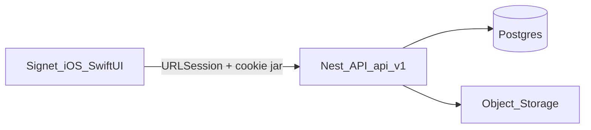

# План: нативное iOS-приложение (кабинет владельца)

Копия плана для удобного открытия (оригинал Cursor Plan: `ios_native_owner_app_ee54037d`).

## Решение (зафиксировано)

- **Стек:** Swift / SwiftUI + URLSession, отдельный target в репо (`apps/ios`).
- **Бэкенд:** текущий Nest API без параллельного «mobile BFF».
- **Скоуп v1:** только кабинет владельца (логин/регистрация email+пароль, список визиток, lifecycle, present/QR, базовое редактирование).
- **Вне v1:** публичный просмотр `/u/{slug}`, VK/Yandex ID, полный паритет edit-v2 (align-диалоги, cover crop), PWA/Capacitor.

## Контекст репозитория

- Auth cookie+JWT: `apps/api/src/auth/session/session.service.ts` (`mq_access` / `mq_refresh`); `AuthGuard` читает access из cookie.
- Карточки: `apps/api/src/cards/cards.controller.ts` — CRUD, publish/unpublish/archive, photo/cover.
- UX-ориентир: `apps/web/src/app/dashboard/`, `apps/web/src/app/cards/[id]/present/`.

## Фаза 0 — API-готовность под native

1. Staging/prod API по HTTPS с фиксированным host для приложения.
2. Mobile auth: `Authorization: Bearer <access>` рядом с cookie; явный `POST /api/v1/auth/refresh` при необходимости.
3. Проверить rate limits `auth:login` / `auth:register`.
4. Короткий контракт Owner API for iOS (endpoints + DTO).

## Фаза 1 — Каркас приложения

1. Xcode project `apps/ios` (iOS 17+, SwiftUI, bundle id `app.signet.owner`).
2. Слои: `App` → `AuthSession` → `APIClient` → screens.
3. `APIClient`: URL из xcconfig (Debug=staging, Release=prod), разбор `error.code/message`.
4. Keychain для access/refresh (Bearer) или cookie jar + Keychain backup.
5. Навигация: Login/Register ↔ RootTab (`Визитки`, `Аккаунт`).

## Фаза 2 — Auth кабинета

1. Регистрация (FIO + email + password), логин, logout.
2. Холодный старт: `GET /api/v1/auth/me`.
3. Ошибки по-русски.
4. Без VK/Yandex в v1.

## Фаза 3 — Список и lifecycle

1. `GET /api/v1/cards` — имя, slug, status (Черновик / Опубликовано / Архив).
2. Опубликовать / Снять с публикации / Удалить (с confirm).
3. Изменить → editor; Показать → present; публичная ссылка через Safari/share.
4. Pull-to-refresh + empty state.

## Фаза 4 — Present / QR (owner)

1. Данные карточки + QR (`.../qr.png` если published).
2. Share sheet: ссылка `/u/{slug}` + QR.
3. Deep link не обязателен в v1.

## Фаза 5 — Редактор (урезанный)

1. Create/edit основных полей через `POST/GET/PATCH /api/v1/cards`.
2. Фото: `POST/DELETE .../photo`.
3. Links: type/url/label.
4. Вне v1: crop/align, полный edit-v2 chrome.

## Фаза 6 — Аккаунт (минимум)

1. `GET/PATCH /api/v1/auth/me`.
2. `POST /api/v1/auth/password`.
3. Удаление аккаунта — позже или простой confirm.

## Фаза 7 — App Store / качество

1. Иконки, splash, Privacy Labels.
2. ATS, staging/prod schemes.
3. TestFlight smoke: auth → create → publish → share → unpublish → delete.
4. Опционально `xcodebuild` на macOS CI.

## Порядок

0 → 1 → 2 → 3 → 4 → 5 → 6 → 7. Первая TestFlight после фазы 4.

## Definition of Done (v1)

- Владелец на iPhone: регистрация/логин, создание, публикация, шаринг QR/ссылки, unpublish, delete.
- Без Capacitor/PWA.
- Получатель по-прежнему только web `/u/{slug}`.
